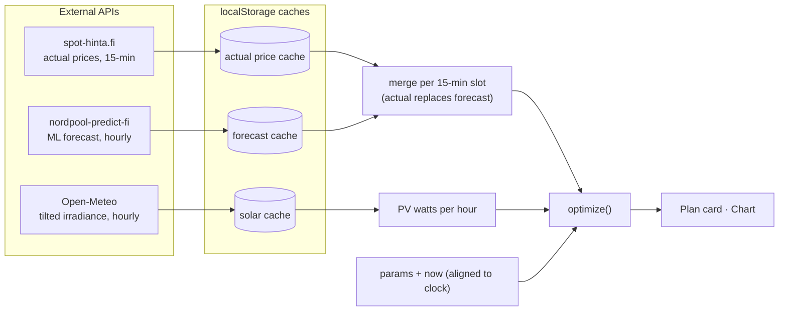
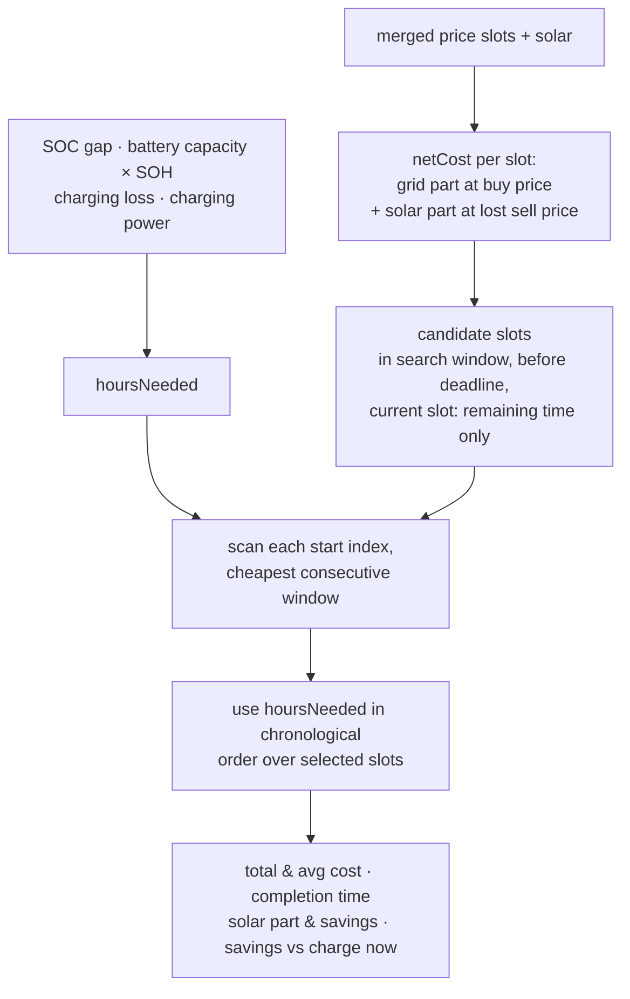
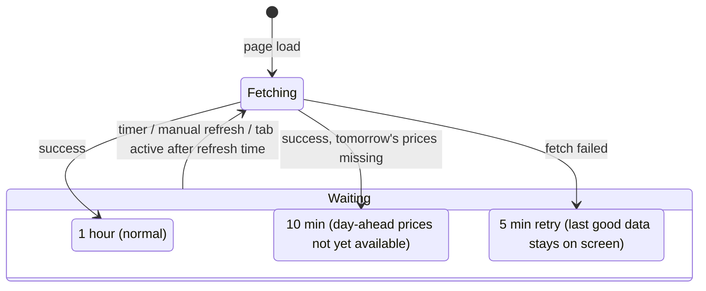

# EV Charging Optimizer

[](https://github.com/ltpk/charging-optimizer/actions/workflows/ci.yml)
[](https://github.com/ltpk/charging-optimizer/actions/workflows/deploy.yml)
[](https://react.dev)
[](https://www.typescriptlang.org)
[](https://vite.dev)
[](https://bun.sh)

**Live: https://ltpk.github.io/charging-optimizer/**

This application finds the cheapest time to charge an electric vehicle (EV). It uses Finnish electricity spot prices. It can also use a solar production forecast to decrease the charging cost. It is for personal use.

## Features

### Prices

- The application uses 15-minute slots for all calculations.
- It gets the actual spot prices for today and tomorrow from [spot-hinta.fi](https://spot-hinta.fi). These prices have a 15-minute resolution, so the plan can find a low price inside an hour.
- For hours that have no actual price, it uses the hourly machine-learning (ML) forecast from [nordpool-predict-fi](https://github.com/vividfog/nordpool-predict-fi). Each forecast hour becomes four 15-minute slots with the same price.
- An actual price always replaces the forecast price for the same slot.

### Solar (optional)

- The application gets a solar forecast from [Open-Meteo](https://open-meteo.com). The forecast gives the global tilted irradiance (GTI) for the tilt and azimuth of your panels.
- It calculates the PV output with this formula: `kWp × GTI/1000 × 0.85`. The value 0.85 is the performance ratio.
- When the solar output supplies a part of the charging power, the charging cost for that part decreases.

### Charging plan

- The optimizer finds the cheapest **consecutive** charging window.
- Charging can start in the current slot. The optimizer uses only the time that remains in that slot. If less than approximately 4 minutes remain, it does not use the slot.
- **Charge by** (optional): The charging must be complete before this hour, for example 07:00. The application shows a warning if the time is too short to get the target state of charge (SOC). It also shows a warning if the deadline is in the past.
- **Start at earliest** (optional): The charging does not start before this hour, for example when you are not at home or the sauna is on. You can use it together with **Charge by** to set the two ends of the window. If this time is in the past, it has no effect.

### Settings

- You can set the battery capacity, the battery state of health (SOH), and the charging loss.
- You can set grid transfer fees. The application adds the electricity tax (sähkövero) to the transfer fee.
- You can set the buy margin and the sell margin. The application adds the Finnish VAT (25.5 %) correctly.
- The application calculates the charging power from these values: 1 phase or 3 phases, charge current, and voltage. The onboard charger of the car sets the maximum power.
- A read-only panel shows the charging speed (%/h), the charging power, and the energy to the battery. When there is a charging loss, it also shows the grid power and the energy from the grid.

### Plan card

The plan card is at the top of the page. It shows:

- The charging time and energy, for example "Charge for 2 h 30 min · 18,3 kWh".
- When to start, for example "Charge now" or "Start at 02.15 tomorrow".
- When the charging is complete, for example "in 3 h 10 min · done by 04.45".
- The estimated cost and the average price in c/kWh. When the transfer fee is on, the card also shows the transfer part of the price.
- The money that you save when you wait, compared to charging from now.
- When solar is on: the percentage of the charge that solar supplies, and the money that solar saves compared to grid-only charging.

Notes:

- If the spot price is negative, solar can increase the cost. Then the card shows "adds … € (negative spot)". The cause: when you use your own solar energy, you do not get paid to use energy from the grid.
- A line at the bottom of the card shows the values for the current slot: spot price, transfer fee, net cost, and solar output. The optimizer uses the net cost to compare slots.
- If the baseline for a saving is less than 0,01 €, the card shows only the amount in €, not the percentage. A negative spot price can make the baseline zero or less.
- All numbers use the Finnish decimal comma, for example 3,45 € and 12,34 c/kWh. Times and dates use the Finnish format, for example 14.30 and 13.10.
- When you scroll down and the card is not visible, the top bar shows a short summary of the plan.

### Price chart

- The chart shows the price for each 15-minute slot as a stepped line.
- All price lines use the same style rule: solid line = actual price, dashed line = forecast, faded line = past.
- The axis labels are hourly. The solar line is a smooth curve.
- The shaded charging window, the night-rate step, and the "now" line align with the real clock times.
- On a phone, the chart has a fixed width for each hour, and you can scroll it horizontally. It opens at the "now" line. Thus a 48 h or 72 h window stays easy to read.
- The night-rate shading and its legend item show only when you use different day and night transfer rates.
- Click a legend item below the chart to hide or show that line or shading. The application keeps this setting after a reload.

### Other features

- **Notification:** The browser can show a notification when the charging window starts. The tab must stay open. Turn it on in the sidebar.
- **Theme:** Use the three buttons in the top bar to select light, system, or dark. The default is system, which follows `prefers-color-scheme`. The application keeps your selection.
- **Layout on a computer:** The everyday controls (battery SOC, search window, charge-by) are in a card next to the results. This card does not move when you scroll.
- **Layout on a phone:** The everyday controls are in a bottom sheet. The SOC sliders are in a card in the main view, so the sheet does not cover the plan when you change them.
- **Setup drawer:** The settings that you set one time (vehicle, energy price, transfer fee, solar) are in the "Vehicle & pricing setup" drawer. On a phone, the drawer uses the full width. The plan stays visible and changes while you edit. The **Restore defaults** button sets all values back to the default values. Info tooltips explain the more difficult fields.
- **Price refresh:** The application keeps all data in `localStorage`. It gets new prices one time each hour. Between approximately 13:00 and 16:00, it gets new prices every 10 minutes until tomorrow's prices are available. You can also click the refresh button.
- **Failed refresh:** If a refresh fails, the last good data stays on the screen, and the application tries again after 5 minutes. If the browser stopped the timers of a background tab, the application gets new data when the tab becomes visible again.
- **Solar refresh:** The solar forecast stays valid for the local calendar day. When solar is on, the application gets a new forecast when the page opens and just after midnight. If you change the location or the panel values, the application tells you to get a new forecast manually.
- **Clock:** The "now" marker, the current-slot status, and the optimal window move forward at the start of each 15-minute slot. They also move forward when the tab becomes active again. A data refresh is not necessary.

## How it works

The three diagrams that follow show the main parts and how they connect. For the exact constants and cache keys, refer to [Features](#features) and the code.

### Data pipeline

Two price sources merge into one series of 15-minute slots. An actual price always replaces a forecast price. The solar data comes from a different source. All data goes into the `optimize()` function:



### Optimizer

The `optimize()` function does these steps:

1. It calculates the hours of charging that are necessary to close the SOC gap.
2. It calculates the cost of each candidate slot with `calcNetCost()`. The cost is the grid part at the buy price **plus** the solar part at the sell price that you do not get.
3. It finds the cheapest consecutive window.
4. It calculates the results in chronological order over the selected slots.



### Price refresh cadence

One loop gets the prices. It has three wait times. A manual refresh stops the wait. A tab that becomes active after its refresh time also stops the wait:



## Development

```bash
bun install       # uses the committed bun.lock
bun run dev       # http://localhost:5173
bun run build     # production build → dist/
bun run preview   # serve dist/ locally
bun run typecheck # tsc --noEmit
bun test          # unit tests (optimization core + pure api helpers)
```

Performance:

- The price chart (Chart.js) loads with `React.lazy` and `Suspense`. Thus it is in a separate bundle chunk (approximately 58 kB gzip), and it loads after the first paint.
- React and MUI are in separate vendor chunks (`vite.config.ts` `manualChunks`). The browser keeps them in its cache after a deploy and downloads only the small app chunk again.
- The price request starts when the module loads (`prewarmPrices()` in `main.tsx`). Thus the network request occurs at the same time as the browser parses the bundle.
- `index.html` connects to the spot-price API before the first request (`preconnect`).
- The favicon is an inline SVG data URI (lightning bolt) in `index.html`. Thus there is no extra request, and no path can break under the Pages subpath.

Each commit runs a Husky pre-commit hook. The hook runs Prettier on the staged files (through lint-staged), then `bun run typecheck`, then `bun test`.

You do not need environment variables or API keys. All APIs are public.

## Configuration

You set the everyday parameters in the sidebar. You set the other parameters in the "Vehicle & pricing setup" drawer. The application saves all parameters automatically. The main parameters are:

| Parameter                  | Description                                                                                                                                                                                                                                           |
| -------------------------- | ----------------------------------------------------------------------------------------------------------------------------------------------------------------------------------------------------------------------------------------------------- |
| SOC now / target           | The current and the necessary battery state of charge (%).                                                                                                                                                                                            |
| Battery capacity           | The usable capacity (kWh) when the battery is new.                                                                                                                                                                                                    |
| Battery health (SOH)       | The percentage of the original capacity that is still available (50–100 %). The energy calculations use capacity × SOH.                                                                                                                               |
| Charging loss              | The energy loss during charging (%). The energy from the grid is more than the energy in the battery.                                                                                                                                                 |
| Onboard charger            | The maximum AC power of the car (kW). The grid power cannot be more than this value.                                                                                                                                                                  |
| Phases / current / voltage | 1 phase or 3 phases, the charge current (A), and the grid voltage (V). Grid power = min(phases × A × V, onboard charger).                                                                                                                             |
| Start at earliest          | Optional. The optimizer uses only the slots that start at this hour or later.                                                                                                                                                                         |
| Charge by                  | Optional. The optimizer uses only the slots that end before this hour.                                                                                                                                                                                |
| Transfer fee               | The grid transfer fee (c/kWh). It is off by default. Select one fixed fee or different day and night rates. The night rate applies from 22:00 to 07:00. The application adds the electricity tax (sähkövero, default 2,92 c/kWh with VAT) to the fee. |
| Retailer margin            | The margin of the retailer on the energy that you buy (c/kWh, without VAT). It is in the Energy price section.                                                                                                                                        |
| Sell margin                | The application subtracts this value from the spot price to calculate the value of the solar energy that you sell. It is in the Solar PV section.                                                                                                     |
| Search window              | The number of hours ahead in which the optimizer looks for the optimal window.                                                                                                                                                                        |
| Solar PV (enable)          | Turns the solar calculation on or off. The panel values stay saved.                                                                                                                                                                                   |
| Base consumption           | The base load of the house (W). This load uses the solar energy first. Only the remaining solar energy decreases the charging cost. The default 0 means that all solar energy is available.                                                           |

## Solar setup

1. Set your location. Click **Get GPS location**, or type the latitude and longitude in the fields. Use the fields if the browser cannot get your location.
2. Set the panel tilt and azimuth. The azimuth uses compass degrees: 0 = N, 90 = E, 180 = S, 270 = W. The application changes the value to the Open-Meteo convention (0 = S) automatically.
3. Set the peak power (kWp) of the panels.
4. Optional: Set the **Base consumption** (W). This is the other load in the house, for example the fridge, standby devices, or the heat pump. This load uses the solar energy before the charger. Only the remaining solar energy decreases the charging cost.
5. Turn on solar. When the location is valid, the application gets the forecast automatically. It gets a new forecast each day.
6. If you change the location or the panel values, click **Fetch solar forecast**. The status line shows a warning when the forecast on the screen does not agree with the settings.

## APIs used

| API                                   | Purpose                                                                                | Cache                                               |
| ------------------------------------- | -------------------------------------------------------------------------------------- | --------------------------------------------------- |
| `api.spot-hinta.fi/today`             | Actual spot prices in 15-min slots. The application adds VAT to the price without tax. | Fetched again until tomorrow's prices are available |
| `api.spot-hinta.fi/dayforward`        | Tomorrow's prices (available at approximately 14:15)                                   | Same                                                |
| `nordpool-predict-fi` prediction.json | Hourly ML forecast for hours that have no actual price                                 | 1 h                                                 |
| `api.open-meteo.com` GTI              | Global tilted irradiance, used to calculate the PV production                          | Calendar day                                        |
| `gc.zgo.at` (GoatCounter)             | Page-view counter without cookies. One hit for each page load.                         | —                                                   |
